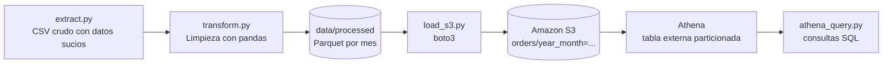

# etl-s3-athena

Pipeline ETL de práctica en AWS: genera datos de pedidos con errores a propósito, los limpia con **Python y pandas**, los guarda como **Parquet particionado por mes**, los sube a **Amazon S3** y los consulta con **SQL en Amazon Athena**.

El objetivo es mostrar un flujo completo de ingeniería de datos: extracción, transformación con control de calidad, carga en la nube y consulta analítica, con credenciales protegidas y una carga repetible (idempotente).

## Arquitectura



| Capa | Herramienta | Función |
|---|---|---|
| Extracción | Python, pandas, NumPy | Genera 5,000 pedidos con duplicados, países mal escritos, cantidades negativas y precios vacíos |
| Transformación | pandas, PyArrow | Limpia, valida y escribe Parquet particionado por `year_month` |
| Almacenamiento | Amazon S3 | Data lake con una carpeta por mes |
| Consulta | Amazon Athena | Tabla externa sobre S3, SQL sin servidores |
| Acceso | IAM, boto3, python-dotenv | Usuario con permisos limitados y claves en archivo local |

## Estructura del repositorio

```
etl-s3-athena/
├── src/
│   ├── check_aws.py      # Verifica credenciales y permisos
│   ├── extract.py        # Genera el CSV crudo
│   ├── transform.py      # Limpieza y escritura en Parquet
│   ├── load_s3.py        # Crea el bucket y sube los archivos
│   └── athena_query.py   # Crea la tabla y ejecuta las consultas
├── data/                 # Ignorado por Git
├── .env                  # Ignorado por Git (claves y nombre del bucket)
├── .gitignore
├── requirements.txt
└── README.md
```

## Cómo funciona cada script

### `extract.py`
Genera con una semilla fija (reproducible) 5,000 pedidos con fecha, cliente, país, categoría, cantidad y precio. Introduce errores a propósito para simular datos reales:
- 50 filas duplicadas.
- 20 cantidades en `-1`.
- 30 precios vacíos.
- Países con distintas escrituras (`Mexico`, `mexico`, `MEXICO`) y valores nulos.

Resultado: `data/raw/orders_raw.csv` con 5,050 filas.

### `transform.py`
Aplica las reglas de calidad en `clean_orders`:
1. Elimina duplicados por `order_id`.
2. Normaliza `country` (espacios, mayúsculas) y reemplaza nulos por `Desconocido`.
3. Convierte `order_date` a fecha y descarta filas sin fecha o sin precio.
4. Descarta cantidades menores o iguales a cero.
5. Calcula `total = quantity * unit_price`.
6. Crea `year_month` y guarda `order_date` como tipo fecha para que Athena lo lea como `date`.

Imprime filas originales, limpias y descartadas, y escribe Parquet particionado por `year_month` en `data/processed/orders`. Resultado: **5,050 filas originales, 4,950 limpias, 100 descartadas**.

### `load_s3.py`
1. `ensure_bucket()` crea el bucket si no existe y es seguro ejecutarlo varias veces.
2. `clear_prefix()` borra los archivos anteriores bajo `orders/`. PyArrow nombra cada archivo con un identificador aleatorio, así que sin este paso las cargas se acumularían y Athena contaría datos duplicados. Con este paso el script es **idempotente**: siempre deja el bucket en un estado conocido.
3. `upload_files()` sube cada Parquet a `orders/year_month=YYYY-MM/`.

### `athena_query.py`
1. Crea la base `etl_demo`.
2. Crea la tabla externa `orders`, particionada por `year_month`, que apunta a `s3://<bucket>/orders/`.
3. Ejecuta `MSCK REPAIR TABLE` para registrar las particiones.
4. Lanza las consultas con `start_query_execution`, espera con `get_query_execution` hasta que terminan y lee los resultados con `get_query_results`.

La segunda consulta filtra por `year_month`. Al ser la columna de partición, Athena lee solo esas carpetas, lo que reduce los datos escaneados y el costo.

## Resultados de ejemplo

Ventas por país:

| País | Pedidos | Ventas |
|---|---|---|
| Mexico | 2,090 | 2,704,512.05 |
| Colombia | 987 | 1,225,992.66 |
| Chile | 767 | 940,053.70 |
| Peru | 621 | 768,253.45 |
| Desconocido | 485 | 633,041.04 |

La suma de pedidos es 4,950, igual que las filas limpias.

## Cómo reproducirlo

Requisitos: Python 3.11, una cuenta de AWS y Git.

```powershell
git clone https://github.com/jalfcc/etl-s3-athena.git
cd etl-s3-athena
conda create -n etl-s3-athena python=3.11 -y
conda activate etl-s3-athena
pip install -r requirements.txt
```

Crea un archivo `.env` en la raíz (no se sube a Git):

```
AWS_ACCESS_KEY_ID=tu_access_key_id
AWS_SECRET_ACCESS_KEY=tu_secret_access_key
AWS_DEFAULT_REGION=us-east-1
BUCKET_NAME=un-nombre-de-bucket-unico
```

Ejecuta en orden:

```powershell
python src/check_aws.py     # verifica credenciales
python src/extract.py       # genera el CSV crudo
python src/transform.py     # limpia y crea los Parquet
python src/load_s3.py       # crea el bucket y sube los archivos
python src/athena_query.py  # crea la tabla y consulta
```

## Seguridad y costos

- Las claves de AWS viven en `.env`, ignorado por Git. Nunca se escriben en el código.
- Se usa un usuario IAM con políticas de S3 y Athena, y no la cuenta raíz, que tiene MFA activado.
- Hay un presupuesto con alerta de costos en AWS Budgets.
- El volumen es pequeño, y Athena cobra según los datos escaneados, así que el costo es mínimo.

## Ideas de mejora

- Pruebas con `pytest` para las reglas de limpieza.
- Validaciones de calidad más completas, con reportes de filas rechazadas.
- Catálogo con AWS Glue y consultas desde dashboards (QuickSight o Power BI).
- Cargar los mismos datos de S3 a Snowflake con una *storage integration*.
- Orquestación con Airflow o con una función programada.

## Autor

Jesús Alfredo Cruz Castro · [GitHub](https://github.com/jalfcc)
